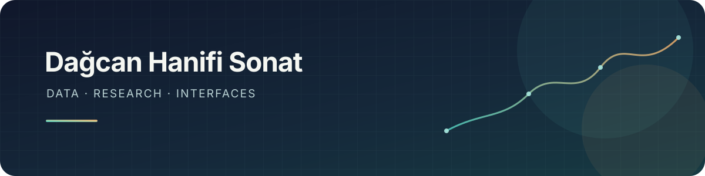

  

<h1 align="center">Hi, I'm Dağcan 👋</h1>

  I build data-driven projects and interfaces that make complex ideas easier to explore.

  <a href="https://orcid.org/0009-0008-3011-8882">ORCID</a>
  &nbsp;·&nbsp;
  <a href="https://github.com/DagcanS?tab=repositories">Projects</a>

---

### What I work on

- **Data and research tools** — analysis, modeling, and clear explanations of how results are produced.
- **Frontend and interaction design** — turning detailed workflows into interfaces people can use.
- **Small experiments** — browser games and tools that make information more engaging.

### Selected projects

| Project | What it is |
| --- | --- |
| [Arşiv Mercek](https://github.com/DagcanS/arsiv-mercek) | A tool for exploring discourse patterns in historical and contemporary Turkish press. |
| [WikiRace](https://github.com/DagcanS/wikiapp) | A browser game about navigating from one Wikipedia article to another. |

### Tools I use

`Python` · `JavaScript` · `TypeScript` · `React` · `SQL` · `CSS`

---

Curious about data, careful about evidence, and always refining the interface.

